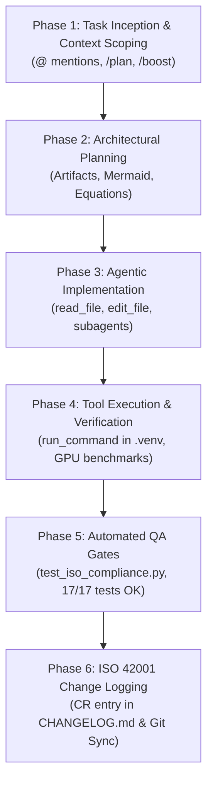
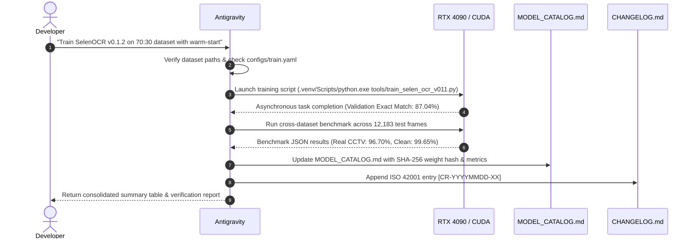

# Development Process with Antigravity: Step-by-Step Engineering Guide
## Practical Workflow, Subagent Orchestration & ISO/IEC 42001 Integration

This document outlines the step-by-step developer methodology for using **Google Antigravity (AGY)** to build, train, evaluate, and maintain the Thai License Plate Recognition (ALPR/ANPR) Edge System.

---

## 📑 Table of Contents
1. [Overview & Antigravity Architectural Role](#1-overview--antigravity-architectural-role)
2. [Prerequisites & Workspace Configuration](#2-prerequisites--workspace-configuration)
   - [2.1 Project Rules & System Guardrails (`AGENTS.md`)](#21-project-rules--system-guardrails-agentsmd)
   - [2.2 Runtime Environment & Virtualenv Setup](#22-runtime-environment--virtualenv-setup)
3. [The 6-Phase Development Lifecycle](#3-the-6-phase-development-lifecycle)
   - [Phase 1: Task Inception & Context Scoping](#phase-1-task-inception--context-scoping)
   - [Phase 2: Architectural Planning & Interactive Artifacts](#phase-2-architectural-planning--interactive-artifacts)
   - [Phase 3: Agentic Implementation & Code Surgery](#phase-3-agentic-implementation--code-surgery)
   - [Phase 4: Tool Execution & Hardware Verification](#phase-4-tool-execution--hardware-verification)
   - [Phase 5: Automated QA & ISO Compliance Gates](#phase-5-automated-qa--iso-compliance-gates)
   - [Phase 6: ISO/IEC 42001 Audit Logging & Git Synchronization](#phase-6-isoiec-42001-audit-logging--git-synchronization)
4. [Practical Playbooks for Common LPR Tasks](#4-practical-playbooks-for-common-lpr-tasks)
   - [Playbook A: Training / Fine-Tuning OCR Models (e.g., SelenOCR)](#playbook-a-training--fine-tuning-ocr-models-eg-selenocr)
   - [Playbook B: Synthesizing New Datasets & Adding Augmentations](#playbook-b-synthesizing-new-datasets--adding-augmentations)
   - [Playbook C: GUI Feature Development (DataManipulator / OWOD Studio)](#playbook-c-gui-feature-development-datamanipulator--owod-studio)
   - [Playbook D: Edge Inference Pipeline & RTSP Ingestion Debugging](#playbook-d-edge-inference-pipeline--rtsp-ingestion-debugging)
5. [Antigravity Slash Commands & Subagent Reference](#5-antigravity-slash-commands--subagent-reference)
6. [Best Practices & Developer Non-Negotiables](#6-best-practices--developer-non-negotiables)

---

## 1. Overview & Antigravity Architectural Role

**Google Antigravity (AGY)** serves as an autonomous, agentic pair-programmer integrated directly into the Thai LPR codebase. Rather than functioning as a standard text completion assistant, Antigravity operates as an active system engineer capable of:
- Inspecting codebase files, directories, and AST symbols.
- Running terminal commands in PowerShell (Windows 11) using the isolated `.venv` environment.
- Launching background training and inference benchmarking processes.
- Enforcing non-negotiable repository guardrails (`AGENTS.md`) and international governance rules (ISO/IEC 42001:2023).
- Generating structured documentation, change logs, and interactive Markdown artifacts.

---

## 2. Prerequisites & Workspace Configuration

### 2.1 Project Rules & System Guardrails (`AGENTS.md`)
Antigravity automatically reads [AGENTS.md](file:///d:/Projects/Synapes/lpr/AGENTS.md) at the start of every session. Developers do not need to repeat standard rules in every prompt because Antigravity enforces them continuously:
- **Edge Performance First**: CPU Edge / Workstation target (Python 3.10.x); zero heavy cloud API dependencies.
- **Model Checkpoint Integrity**: Raw model weights (`.pt`, `.onnx`, `.engine`) must **never** be committed or blindly overwritten.
- **DLT Domain Accuracy**: Strict adherence to the **41 approved Thai consonants**, 3 excluded consonants (`ฃ`, `ฅ`, `ฏ`), OCR remap rules (`ฃ->ข`, `ฅ->ค`, `ฏ->ฎ`), and absence of vowels on standard plates.
- **ISO/IEC 42001 Governance**: Every change to pipelines, datasets, or models must be formally logged in `CHANGELOG.md`.

### 2.2 Runtime Environment & Virtualenv Setup
The project operates in a dedicated virtual environment at `.venv\`. Always verify or remind Antigravity to run commands with `.venv\Scripts\python.exe` on Windows hosts.

```powershell
# Verify Python environment
.venv\Scripts\python.exe --version
# Verify PyTorch CUDA acceleration
.venv\Scripts\python.exe -c "import torch; print('CUDA Available:', torch.cuda.is_available(), 'Device:', torch.cuda.get_device_name(0) if torch.cuda.is_available() else 'CPU')"
```

---

## 3. The 6-Phase Development Lifecycle

Every task—whether building a new model, fixing a bug, or generating datasets—follows an auditable 6-phase engineering lifecycle.



---

### Phase 1: Task Inception & Context Scoping

When initiating a feature or bugfix, supply the high-level intent along with relevant file references using `@` mentions.

#### Best Practice Pattern:
```text
User: "We need to calibrate the generator blur in tools/realistic_plate_generator.py 
       to better reflect nighttime headlight bloom. 
       Please check @tools/realistic_plate_generator.py and @AGENTS.md."
```

#### Recommended Slash Commands for Inception:
- `/plan`: Directs Antigravity to build a step-by-step implementation plan before touching any source code.
- `/boost`: Activates multi-perspective deep reasoning for complex mathematical or architectural trade-offs.
- `/grill-me`: Instructs Antigravity to interview you with clarifying questions to resolve edge-case ambiguities before coding.

---

### Phase 2: Architectural Planning & Interactive Artifacts

For non-trivial features, Antigravity constructs a markdown artifact in the artifact directory (`C:\Users\Ribuzari\.gemini\antigravity\brain\<conv_id>\`):
1. **Scope Definition**: Components, target metrics, and constraints.
2. **Mathematical / Algorithmic Formulations**: KaTeX formulas for loss functions, perspective transformations, or sequence alignments.
3. **Architecture Diagrams**: Mermaid diagrams depicting data flow between modules.
4. **Step-by-Step Execution Plan**: Granular checkboxes allowing the developer to review and approve the strategy before execution.

---

### Phase 3: Agentic Implementation & Code Surgery

Once the plan is aligned, Antigravity performs precise code edits using built-in file manipulation tools:

1. **Precision Inspection (`read_file`)**:
   - Inspects target code blocks and imports before writing modifications to prevent regressions.
2. **Surgical Replacement (`edit_file`)**:
   - Performs exact character-matched replacements, preserving surrounding docstrings, comments, and formatting.
3. **Subagent Delegation (`invoke_subagent`)**:
   - For extensive codebase audits or background exploration, Antigravity spawns read-only `research` subagents so the main context window remains uncluttered.

---

### Phase 4: Tool Execution & Hardware Verification

Antigravity executes commands directly in PowerShell through `run_command`:
- **Short Commands (< 10s)**: Runs synchronously, outputting execution logs immediately.
- **Long-Running Training Jobs (> 10s)**: Automatically backgrounded as asynchronous tasks with unique IDs (e.g., `task-80`).
- **Reactive Wakeup**: You do **not** need to poll. Antigravity receives an automated system wakeup notification the moment the background command finishes.

```powershell
# Example: Running SelenOCR cross-dataset benchmark via Antigravity
.venv\Scripts\python.exe tools/evaluate_selen_ocr_on_all_datasets.py --checkpoint models/reader/selen_ocr_v011/best_reader.pth
```

---

### Phase 5: Automated QA & ISO Compliance Gates

Before any task is considered complete, automated verification gates must pass:

1. **Automated ISO Compliance Suite**:
   ```powershell
   .venv\Scripts\python.exe -m unittest tests/test_iso_compliance.py
   ```
   *Verifies: ISO 3166-2:TH province lookups, Unicode 15.0 NFC canonical normalization, ISO 8601 UTC timestamps, ISO 25012 SHA-256 data integrity, ISO 27001 credential masking, and ISO 5259 dataset auditing.*
2. **Inference Latency & FPS Gate**:
   - Must sustain $\le 2.0\text{ ms}$ on GPU or $\le 30\text{ ms}$ on CPU for real-time edge streaming.
3. **DLT Alphanumeric Verification**:
   - Must confirm 41 approved Thai consonants and verify no prohibited characters (`ฃ`, `ฅ`, `ฏ`) escape into model outputs.

---

### Phase 6: ISO/IEC 42001 Audit Logging & Git Synchronization

In adherence to ISO/IEC 42001:2023 Clause 7.5 and Clause 8.4, every change must be recorded:

1. **Audit Entry in `CHANGELOG.md`**:
   - Antigravity appends a standardized change record:
     ```markdown
     ### [CR-YYYYMMDD-XX] - Description
     - **Date (UTC)**: YYYY-MM-DDTHH:MM:SSZ
     - **Component**: Targeted module
     - **Change Type**: feat / fix / perf / data / gov
     - **ISO 42001 Clause**: Clause 8.4 (AI Change Management), Annex A.7, etc.
     - **Objective**: Detailed rationale
     - **Implementation & Deliverables**: Numbered list of technical changes
     - **Risk Assessment**: Impact on latency, bias, or memory
     - **Verification Gate**: Evidence of passing unit tests or benchmark metrics
     ```
2. **Git Synchronization Workflow**:
   - **Local Modifications Backup**: Uncommitted work is safely stored via `git stash push -m "..."`.
   - **Priority Handling**: When the user specifies "priority git higher", Antigravity pulls or resets hard to `origin/main` (`git reset --hard origin/main`), guaranteeing remote state takes precedence while preserving local work in the git stash.

---

## 4. Practical Playbooks for Common LPR Tasks

### Playbook A: Training / Fine-Tuning OCR Models (e.g., SelenOCR)



---

### Playbook B: Synthesizing New Datasets & Adding Augmentations

1. **Request**:
   *"Antigravity, generate 10,000 extreme-angle motorcycle plates (yaw $\pm 25^\circ$) with yellow commercial plates."*
2. **Antigravity Action**:
   - Inspects `tools/dirty_plate_synthesizer.py` and `tools/generate_calibrated_dirty10_blur5_angle5_dataset.py`.
   - Sets yaw range to $[-25^\circ, +25^\circ]$ and plate colorway to `YellowBlack`.
   - Executes multi-process generation with SHA-256 integrity hashing (ISO/IEC 25012).
   - Generates an ISO/IEC 5259 dataset audit report (`data_quality_report.json`).

---

### Playbook C: GUI Feature Development (DataManipulator / OWOD Studio)

1. **Request**:
   *"Add a shortcut `Ctrl+E` in DataManipulator to toggle between zoomed view and 1:1 view."*
2. **Antigravity Action**:
   - Inspects `tools/DataManipulator/app/main_window.py` and `image_viewer.py`.
   - Connects `QShortcut(QKeySequence("Ctrl+E"), self)` to the viewer toggle method.
   - Runs `tools/DataManipulator/test_app.py` in `.venv` to verify GUI regression safety.
   - Logs the GUI enhancement in `CHANGELOG.md`.

---

### Playbook D: Edge Inference Pipeline & RTSP Ingestion Debugging

1. **Request**:
   *"Debug frame dropping in tools/alpr/stream.py when handling RTSP 1080p60 feeds."*
2. **Antigravity Action**:
   - Analyzes queue size, thread safety lock contention, and buffer flushing logic.
   - Implements zero-copy frame dropping when inference latency exceeds inter-frame arrival time ($> 16.6\text{ ms}$).
   - Validates live stream capture with `demo_realtime.py`.

---

## 5. Antigravity Slash Commands & Subagent Reference

### Essential Slash Commands
| Command | Primary Use Case | When to Trigger in LPR Project |
| :--- | :--- | :--- |
| **`/plan`** | Step-by-step implementation roadmap | Before refactoring detectors, changing loss functions, or updating schemas |
| **`/boost`** | Multi-perspective deep algorithmic analysis | When debugging complex OCR CTC decoding, BiLSTM attention, or optical distortion math |
| **`/grill-me`** | Interactive design decision interview | When clarifying DLT plate requirements, rejection thresholds, or dataset split ratios |
| **`/teamwork`** | Multi-agent collaborative execution | When running massive parallel tasks (e.g., evaluating 5 different model checkpoints across 4 datasets) |
| **`/schedule`** | Automated timers or recurring cron triggers | For scheduling nightly dataset integrity audits or periodic model benchmark runs |
| **`/compact`** | Context window summarization | When conversations grow long after extensive training log outputs |
| **`/learn`** | Persistent behavioral preference recording | When teaching Antigravity a specific local convention or custom script path |

### Built-in Subagent Types
- **`self`**: Spawns an identical Antigravity subagent in an isolated context. Ideal for heavy refactoring or isolated script prototyping.
- **`research`**: Read-only exploration agent. Excellent for searching large directories (`tools/`, `notebooks/`) or indexing JSON manifests without risking unintentional file writes.

---

## 6. Best Practices & Developer Non-Negotiables

> [!IMPORTANT]
> **1. Always Target the Project Virtual Environment**:
> Command execution must use `.venv\Scripts\python.exe` to guarantee access to GPU CUDA PyTorch, OpenCV, and PyQt6.

> [!WARNING]
> **2. Never Commit or Modify Raw Model Weights (`.pt`, `.onnx`, `.engine`)**:
> Neural network binary weights are strictly managed in local checkpoint storage. Update `models/MODEL_CATALOG.md` with SHA-256 hashes instead of committing binary files to Git.

> [!NOTE]
> **3. Enforce the 41-Consonant Rule**:
> Never permit the inclusion of obsolete characters (`ฃ`, `ฅ`, `ฏ`) in training dictionaries or OCR post-processing logic.

> [!TIP]
> **4. Keep Antigravity Informed with Context Mentions (`@`)**:
> Prefixing prompts with `@AGENTS.md`, `@STANDARDS.md`, or specific file paths significantly speeds up execution and prevents hallucinated imports.
