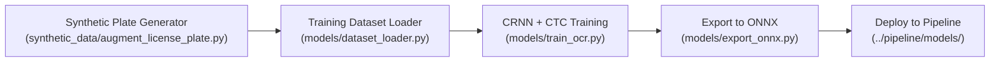

# Thai License Plate OCR Model Training Suite

Complete dataset generation, character morphology analysis, glyph extraction, and CRNN (CNN + BiLSTM + CTC) OCR model training pipeline for Thai license plates and 77 provinces.

```
training_ocr/
├── synthetic_data/                 # 77-Province Synthetic Plate Generator & Augmentor
│   ├── augment_license_plate.py    # Generates realistic plates with dirt, lighting, blur, and warps
│   ├── generate_sample.py          # Quick sample plate generator
│   ├── fonts/                      # TrueType Thai fonts (THSarabunNew, NotoSansThai)
│   ├── font_assets/                # Plate background templates and seal graphics
│   └── augmented_plates/           # Pre-generated synthetic plate crops
├── character_bank/                 # Morphological Analysis & Character Segmentation
│   ├── crop_characters.py          # Hough deskewing, CLAHE, projection splitting, CCA
│   ├── font_analyzer.py            # Stroke width and character aspect ratio profiler
│   ├── organize_crop_folders.py    # Groups glyphs into class folders (AA-ZZ, 0-9)
│   ├── char_bank/                  # Isolated real Thai character crops
│   └── organized_crops/            # Labeled character folders
├── models/                         # PyTorch CRNN OCR Architecture & Export
│   ├── char_vocab.py               # Thai character & province vocabulary index
│   ├── dataset_loader.py           # PyTorch Dataset loader with CTC sequence encoding
│   ├── train_ocr.py                # CRNN (CNN + BiLSTM + CTC Loss) training engine
│   └── export_onnx.py              # Exports PyTorch .pt -> ONNX with dynamic width
├── generate_synthetic.bat          # 1-Click launcher to generate 77-province synthetic plates
├── train_ocr.bat                   # 1-Click interactive OCR training launcher
└── README.md                       # This documentation
```

---

## 1. Quickstart Workflow



### Step 1: Generate Synthetic Plates (77 Provinces)
```powershell
.\generate_synthetic.bat --samples-per-province 100 --output synthetic_data/augmented_plates
```

### Step 2: Train CRNN OCR Model
```powershell
python -m training_ocr.models.train_ocr --data-dir synthetic_data/augmented_plates --epochs 50 --batch 32
```

### Step 3: Export to ONNX and Deploy to Pipeline
```powershell
python -m training_ocr.models.export_onnx --weights thai_plate_crnn.pt --deploy-to-pipeline
```
This automatically produces an optimized `.onnx` model ready for production edge inference inside `../pipeline/models/`.
